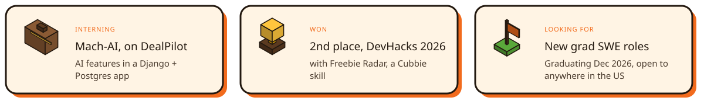
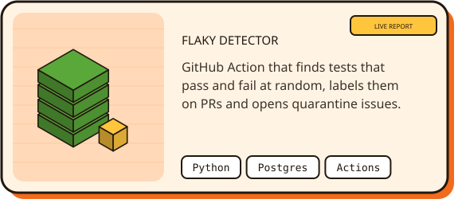
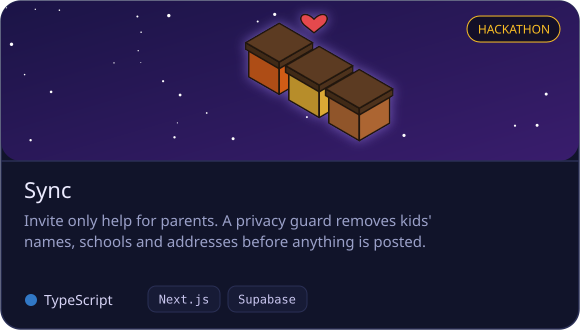
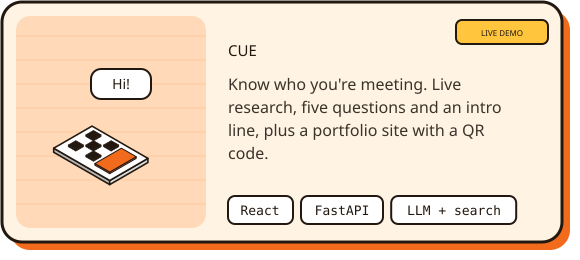
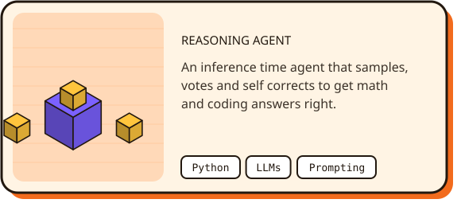
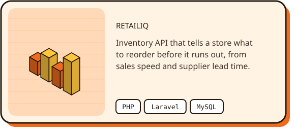
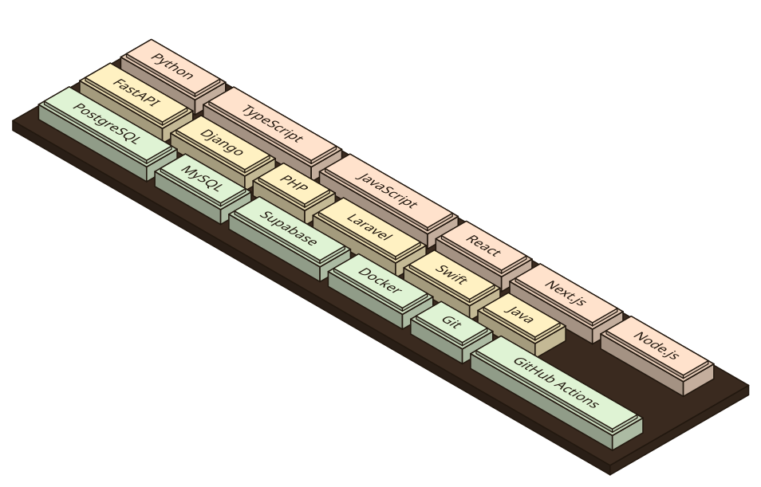
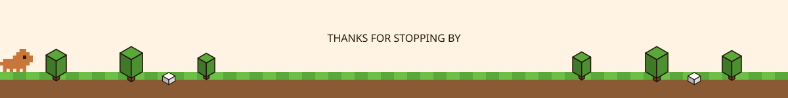

  

  
  
  

  

I'm a Computer Science senior at **Arizona State University**, graduating in **December 2026**. I've interned as a software developer at **Neuramod** (iOS, Swift) and as a software engineer at **Endless Moments** (an HR and payroll platform), I'm interning at **Mach-AI** now, and I was a TA for CSE 360.

## Right now

## Featured projects

## Tech stack

  

## GitHub stats

  
  

  

