  

  
  
  

Hi, I'm Manaswi! I'm a Computer Science senior at **Arizona State University**, graduating in **December 2026**. I like building things people actually use: full stack apps, AI agents and developer tools. Before this, I interned as a software developer at **Neuramod** (iOS, Swift) and as a software engineer at **Endless Moments** (an HR and payroll platform), and I was a TA for CSE 360.

## Right now

## Things I built

## Tech stack

  

## GitHub activity

  
  

  

